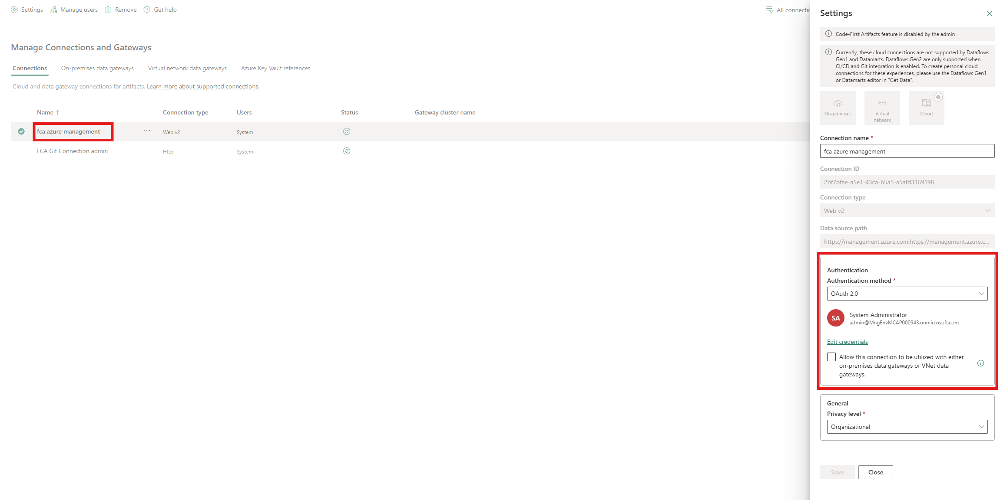
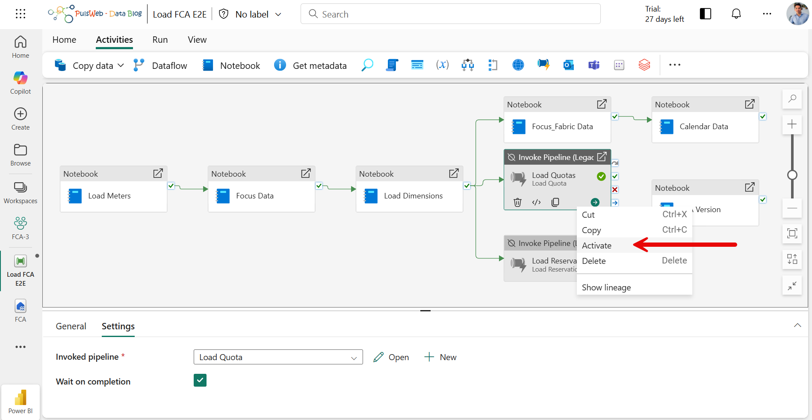

# Quota

🎬 Quota setup demo available on YouTube: [Fabric Cost Analysis - Azure Quotas deployment](https://youtu.be/ssPdqZQyyEg)

Quota analysis is **optional**. It collects the [Microsoft Fabric quotas](https://learn.microsoft.com/en-us/fabric/enterprise/fabric-quotas) of your Azure subscriptions (the ones you see in the Azure portal under *Quotas > Microsoft Fabric*) and shows, for each subscription, region and quota, the **limit**, the **usage**, the **remaining quota** and the **utilization**, so you can spot the quotas approaching their limit before a capacity creation or a resize fails.

## What FCA collects

For every subscription of the FCA `subscriptions` table (the subscriptions having Fabric cost in the FOCUS data) and every Azure region where Microsoft Fabric is available (54 regions), FCA stores one row per quota:

| Quota id (`QuotaId`) | Quota name in the Azure portal (`QuotaName`) | Unit |
| --- | --- | --- |
| `CapacityQuota` | CapacityQuota | CU |
| `ServerlessEnabledCapacities` | On-demand enabled capacities | Count |
| `AIDataTransform` | AI data transform On-demand CU hours per day | CUhrs |
| `AppDevFunctionsAndAPIs` | Application Development On-demand CU hours per day | CUhrs |
| `Copilot` | Copilot On-demand CU hours per day | CUhrs |
| `CosmosDB` | Cosmos DB On-demand CU hours per day | CUhrs |
| `DataAgents` | Data Agents On-demand CU hours per day | CUhrs |
| `DataFactory` | Data Factory On-demand CU hours per day | CUhrs |
| `DataScience` | Data Science On-demand CU hours per day | CUhrs |
| `DataWarehouse` | Data Warehouse On-demand CU hours per day | CUhrs |
| `OneLake` | OneLake On-demand CU hours per day | CUhrs |
| `PowerBI-CoreServices` | Power BI core services On-demand CU hours per day | CUhrs |
| `PowerBI-SemanticModels` | Power BI semantic models On-demand CU hours per day | CUhrs |
| `RealTimeIntelligence-EventHouse` | Real-Time Intelligence - Eventhouse On-demand CU hours per day | CUhrs |
| `SQLDatabase` | SQL Database On-demand CU hours per day | CUhrs |
| `Fabric-IQ` | Fabric IQ On-demand CU hours per day | CUhrs |
| `RealTimeIntelligence` | Real-Time Intelligence On-demand CU hours per day | CUhrs |
| `DataMirroring` | Mirroring On-demand CU hours per day | CUhrs |
| `VNetDataGateway` | VNet Data Gateway On-demand CU hours per day | CUhrs |
| `HorizonDBDatabase` | HorizonDB Database On-demand CU hours per day | CUhrs |

This list is what the Azure API returned on 2026-11-26 for a subscription: it is **not hardcoded** in FCA. FCA stores whatever the API returns, so quotas added by Microsoft later are collected without any change. The limits and usages are never hardcoded either, they always come from the API. All the quotas shown in the Azure portal are available through the API (the portal and FCA use the same data), there is no known quota that FCA cannot retrieve.

- **Capacity quota** (`CapacityQuota`, in CU) is shared by all the capacities of a subscription and a region: creating or resizing a capacity uses part of it.
- **On-demand billing quotas** (`... On-demand CU hours per day`, in CUhrs) are configured per billing category, subscription and region. According to the [Microsoft documentation](https://learn.microsoft.com/en-us/fabric/enterprise/fabric-on-demand-billing-quotas), the limit applies independently to each capacity where the category is enabled.
- **On-demand enabled capacities** (`ServerlessEnabledCapacities`, a count) limits the number of F0 and hybrid capacities using on-demand billing.

> ℹ️ **Limit and usage**: the *limit* is the quota configured by Azure for the subscription and the region. The *usage* (`currentValue`) is what Azure counts against this quota (for the capacity quota: the CU of the provisioned capacities and of the configured overage thresholds). FCA does not compute any consumption itself and the usage is a snapshot taken when the pipeline runs. The actual CU consumption of your capacities is in the *Capacity Usage* page of the report.

## How it works

1. The **Load Quota** pipeline reads the subscriptions from the FCA `subscriptions` table. For each subscription it calls the Azure Resource Manager batch endpoint 3 times (the batch endpoint accepts 20 requests at most, FCA sends 17, 17 and 20 regions) and saves the raw responses in `Files/Data/Quotas` of the FCA Lakehouse.
2. The **02_Load_Quota_Fabric** notebook reads these files and writes the `quota_fabric` Delta table: one row per subscription, region, quota and day. It keeps **one snapshot per day** (running it twice the same day replaces the data of the subscriptions it collected). Requests that failed are reported in the notebook output and skipped, they do not stop the load of the other subscriptions and regions. If nothing could be collected, the existing data is kept.
3. The semantic model and the **Quota** page of the report read the `quota_fabric` table.

The pipeline is part of the *Load FCA E2E* pipeline (optional *Load Quotas* activity) and can be scheduled daily with it. A daily run is recommended since the page uses the latest snapshot of the selected period.

### Azure REST API

| | |
| --- | --- |
| API | [Fabric Capacities - List Usages](https://learn.microsoft.com/en-us/rest/api/microsoftfabric/fabric-capacities/list-usages) |
| Request | `GET https://management.azure.com/subscriptions/{subscriptionId}/providers/Microsoft.Fabric/locations/{location}/usages?api-version=2023-11-01` (`2023-11-01` is the version documented as supported for quotas) |
| Batching | `POST https://management.azure.com/batch?api-version=2020-06-01` with up to 20 requests of the form above (the batch endpoint is the one used by the Azure portal) |
| Response | `value[]` with `name.value` (quota id), `name.localizedValue` (quota name), `unit`, `currentValue` (usage), `limit` |
| Scope | One call per subscription and per region |
| Authentication | OAuth 2.0 / service principal of the `fca azure management` connection, token audience `https://management.azure.com` |
| Permissions | The identity of the connection needs, on each subscription, the **Contributor** role or another role including Contributor access, as documented by Microsoft to view the Fabric quotas. The `Microsoft.Fabric` resource provider must be registered on the subscription. To *request* a quota increase (not done by FCA) the *Quota Request Operator* permissions are required. |

## 1 - Configure the data connection

The installation notebook (00_Deploy_FCA) **automatically created** the following cloud connections :

| | Connection  |
|-------------| ------------- |
|Connection Name| fca azure management  |
|Connection Type| Web v2  |
|Base Url| https://management.azure.com  |
|Token Audience Url| https://management.azure.com|
|Authentication|OAuth 2.0 or SPN|

Add credentials to connections :

- Navigate under Settings to 'Manage connections and gateways' in Fabric
- Set the credentials of the connections with your Oauth2 account or a service principal:

> ℹ️ This connection is used in FCA pipeline to retrieve Quota data from Azure Management REST APIs. If the credentials are incorrect or the secret has expired, the pipeline will fail. In case of an error, you'll be able to run the notebook again. It has an update mechanism, which will act as an item update. To view your Fabric quota, you need an Azure account with the contributor role, or another role that includes contributor access ([Microsoft Fabric quotas](https://learn.microsoft.com/en-us/fabric/enterprise/fabric-quotas?tabs=Azure)).

## 2 - Enable activity and run the Pipeline

- Open the **Load FCA E2E** Data pipeline
- Activate the **Load Quotas** activity

- Save and go back to deployment documentation : [Deployment documentation](./Deploy.md#-optional-steps)

If you don't have the required permission on some subscriptions, FCA still loads the quotas of the other ones: the output of the **Load Quota to lakehouse** notebook activity lists the requests that failed (for example `HTTP 403 AuthorizationFailed`) and the loaded subscriptions. A missing permission never impacts the other FCA data (cost, reservations...), the *Load Quotas* activity is independent from them.

## Data model

Table `quota_fabric` (Lakehouse) and semantic model:

| Column | Description |
| --- | --- |
| `SubscriptionKey` | Subscription (relationship with `subscriptions`) |
| `RegionId` | Azure region (relationship with `capacity_regions`) |
| `QuotaId`, `QuotaName` | Quota identifier and quota name as displayed in the Azure portal |
| `Unit` | `CU`, `CUhrs` or `Count` |
| `Limit` | Quota limit (API `limit`) |
| `Usage` | Current usage (API `currentValue`) |
| `DateKey` | Day of the snapshot (relationship with `calendar`) |
| `CollectionTimestamp` | Date and time of the collection |

Measures of the semantic model (table `quota_fabric`):

| Measure | Description |
| --- | --- |
| `Quota Limit`, `Quota Used` | Limit and usage of the selected quota |
| `Quota Remaining` | Limit - usage (negative above the limit) |
| `Quota Consumed` | Utilization: usage / limit |
| `Quota Status` | `OK`, `Warning` (from 80%) or `Critical` (from 95%). The thresholds are the hidden measures `Quota Warning Threshold` and `Quota Critical Threshold`, edit them to change the thresholds |
| `Quota Max Consumed` | Highest utilization among the selected quotas |
| `# Quotas Critical`, `# Quotas Warning`, `# Quotas OK` | Number of quotas (subscription, region and quota) by status |
| `Quota Snapshot Date`, `Quota Last Collected` | Day and time of the snapshot shown |

How the measures aggregate:

- Values are taken from the **most recent snapshot of the period selected** in the report. Snapshots of several days are never added up.
- Limit and usage are added up across subscriptions and regions **for quotas with the same unit** (for example the total capacity quota of several regions). When the selection mixes quotas with different units (for example all the quotas of a region), `Quota Limit`, `Quota Used`, `Quota Remaining` and `Quota Consumed` are **blank**: select a quota with the *Quota* slicer or the table. `Quota Max Consumed` and the `# Quotas ...` measures are always comparable.

## The Quota page

The **(optional) Quota** page of the report shows:

- the number of quotas by status (OK / Warning / Critical) and the highest utilization per region on a map,
- a table per subscription, region and quota with the limit, usage, remaining quota, utilization bar, utilization % and status, sorted by utilization,
- slicers on date, subscription, region and quota, the *Only show quotas with usage* toggle and the date of the snapshot shown.

## Upgrade from a previous version

Customers who deployed FCA before version **2026.11.26** (the quota table only had `RegionId`, `Usage`, `Limit`, `DateKey` and `SubscriptionKey` and **did not store which quota each value belongs to**) do not need to reinstall FCA:

1. Follow the standard [update procedure](./Deploy.md#update) (new `00_Deploy_FCA` notebook, run it). The deployment overwrites the FCA items (notebooks, *Load Quota* pipeline, semantic model and report) and runs the `Init_FCA_Lakehouse_Tables` notebook, which **adds the new columns (`QuotaId`, `QuotaName`, `Unit`, `CollectionTimestamp`) to the existing `quota_fabric` table**. The existing rows are kept and nothing is reloaded. No new permission and no new configuration are needed, the existing `fca azure management` connection is reused.
2. If you had activated the **Load Quotas** activity in the *Load FCA E2E* pipeline, activate it again (the update resets the pipeline to its defaults).
3. Run the *Load FCA E2E* pipeline (or only the *Load Quota* pipeline) **once**. The quotas are then collected with their name, unit and collection time.

What to expect after the upgrade:

- The data collected by the previous versions has no quota name (the name was not stored, it cannot be recovered). It stays in the table but it is **not displayed** in the new Quota page: the history by quota starts with the first run after the upgrade.
- Until the first run, the Quota page is empty.
- The Quota page of the report must be the one of the new version: the previous page added up quotas with different units (this is why a region showed a limit of 309,428, the sum of its quotas in CU, CU hours and counts).
- If you only updated the notebooks without running the deployment notebook, the *02_Load_Quota_Fabric* notebook adds the missing columns by itself at its first run. Refresh the SQL endpoint of the Lakehouse and the semantic model afterwards.

## Known limitations

- Only the subscriptions of the FCA `subscriptions` table (Fabric cost found in the FOCUS data) are queried: a subscription having Fabric quotas but no Fabric cost yet is not shown.
- The list of regions is defined in the variables `body_region1` to `body_region3` of the *Load Quota* pipeline (54 regions, the ones returned by the `Microsoft.Fabric` resource provider on 2026-11-26, 20 requests per batch at most). A new Azure region requires an update of the pipeline.
- The batch endpoint (`/batch`) is the one used by the Azure portal. Microsoft documents the *List Usages* API, not this batch wrapper.
- The API is paged (`nextLink`) but returns all the quotas in a single page today. FCA loads the first page only and reports a warning if a `nextLink` is returned.
- Usage and limit are stored as 32-bit integers.
- The usage is the value Azure reports when the pipeline runs. FCA keeps one snapshot per day, a quota that peaked and dropped between two runs is not visible.
- It has not been verified whether a role lower than Contributor (for example Reader) is enough to read the quotas. Microsoft documents Contributor.
- Quota alerts and quota increase requests are not part of FCA, use the Azure portal ([Quota monitoring and alerting](https://learn.microsoft.com/en-us/azure/quotas/monitoring-alerting)).
